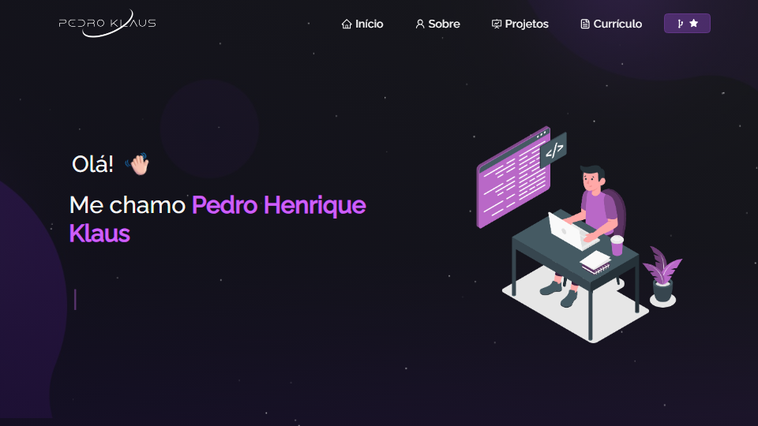
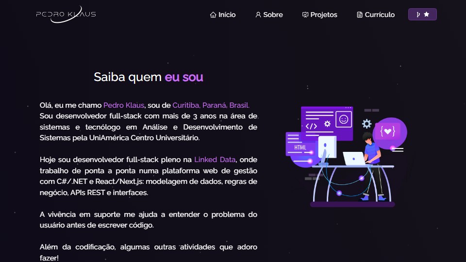
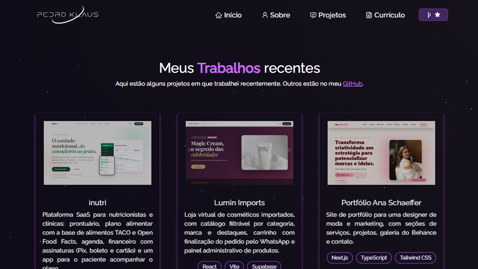

<div align="center">

# Pedro Klaus · Portfólio

**Desenvolvedor Full-Stack Pleno** · C# · .NET · React · Next.js

[](https://klausdev.netlify.app)
[](https://www.linkedin.com/in/pedro-henrique-klaus-25920b1b5/)
[](https://github.com/PedroKklaus)


<br />



</div>

---

## Sobre

Meu portfólio pessoal: quem sou, onde trabalhei, o que sei fazer e os projetos que construí. O site é **100% estático**: o Next.js gera um HTML pronto para cada página, então ele carrega rápido e aparece bem no Google e nas prévias de link do LinkedIn e do WhatsApp.

## Páginas

| Página | Rota | O que tem |
| --- | --- | --- |
| **Início** | `/` | Apresentação, foto e redes sociais |
| **Sobre** | `/about/` | Resumo, linha do tempo da experiência profissional, skills e ferramentas |
| **Projetos** | `/project/` | Projetos com print, descrição, tecnologias e links de demo/código |
| **Currículo** | `/resume/` | Currículo para ver no site e botão para baixar em PDF |

<table>
  <tr>
    <td></td>
    <td></td>
  </tr>
  <tr>
    <td align="center"><sub>Sobre</sub></td>
    <td align="center"><sub>Projetos</sub></td>
  </tr>
</table>

## Projetos em destaque

| Projeto | Stack | Link |
| --- | --- | --- |
| **inutri**: plataforma SaaS para nutricionistas e clínicas | Next.js · TypeScript · Tailwind | [Demo](https://inutri-teste-ten.vercel.app/) |
| **Lumin Imports**: loja de cosméticos importados com pedido via WhatsApp | React · Vite · Supabase | [Demo](https://luminimports.vercel.app/) |
| **Portfólio Ana Schaeffer**: site para designer de moda e marketing | Next.js · TypeScript · Tailwind | [Demo](https://portfolio-ana-mu.vercel.app/) · [Código](https://github.com/PedroKklaus/Portfolio-ANA) |
| **CCIAR**: sistema para o Centro de Convivência do Idoso de Foz do Iguaçu | Java · Spring Boot · PostgreSQL | [Código](https://github.com/CCIAR-PI/Projeto-Integrador-CCIAR) |

## Tecnologias do site

- **[Next.js 16](https://nextjs.org/)** (App Router) com exportação estática
- **[React 19](https://react.dev/)** e **[TypeScript](https://www.typescriptlang.org/)**
- **[React Bootstrap](https://react-bootstrap.netlify.app/)** para layout e componentes
- **[tsParticles](https://particles.js.org/)** no fundo animado
- **[react-icons](https://react-icons.github.io/react-icons/)**, **[typewriter-effect](https://www.npmjs.com/package/typewriter-effect)** e **[react-parallax-tilt](https://www.npmjs.com/package/react-parallax-tilt)**
- Fonte **Raleway** via `next/font`

## Rodando localmente

Requisitos: **Node.js 20+** e npm.

```bash
git clone https://github.com/PedroKklaus/testeportifolio.git
cd testeportifolio
npm install
npm run dev
```

Abra [http://localhost:3000](http://localhost:3000).

| Comando | O que faz |
| --- | --- |
| `npm run dev` | Servidor de desenvolvimento com recarregamento automático |
| `npm run build` | Gera o site estático na pasta `out/` |
| `npm start` | Serve a pasta `out/` localmente (rode o build antes) |
| `npm run typecheck` | Checa os tipos do TypeScript |

## Estrutura

```
├── app/                    # Rotas (App Router)
│   ├── layout.tsx          # Layout, SEO e Open Graph globais
│   ├── page.tsx            # /
│   ├── about/page.tsx      # /about
│   ├── project/page.tsx    # /project
│   ├── resume/page.tsx     # /resume
│   ├── not-found.tsx       # Página 404
│   └── globals.css         # Estilos do site
├── components/             # Componentes de cada seção
├── assets/                 # Imagens importadas pelos componentes
├── public/                 # Arquivos servidos direto (PDF do currículo, favicon, og-image)
├── next.config.ts          # Exportação estática
└── netlify.toml            # Configuração de deploy
```

## Atualizando o conteúdo

| Quero mudar... | Arquivo |
| --- | --- |
| Experiência profissional | `components/About/Experience.tsx` |
| Skills e competências | `components/About/Techstack.tsx` |
| Ferramentas | `components/About/Toolstack.tsx` |
| Texto do "Saiba quem eu sou" | `components/About/AboutCard.tsx` |
| Projetos | `components/Projects/Projects.tsx` (prints em `assets/Projects/`) |
| Redes sociais | `components/socialLinks.tsx` |
| Currículo | `assets/Curriculo.png` (imagem) e `public/Pedro_Henrique_Klaus_Curriculo.pdf` (download) |
| Título e descrição para SEO | `app/layout.tsx` e o `metadata` de cada `page.tsx` |

## Deploy

O site é publicado no **Netlify**. O `netlify.toml` já define o comando de build (`npm run build`) e a pasta publicada (`out`), então cada push na branch configurada no Netlify publica uma nova versão.

---

<div align="center">

Feito por **Pedro Henrique Klaus** · Curitiba, PR

[Site](https://klausdev.netlify.app) · [LinkedIn](https://www.linkedin.com/in/pedro-henrique-klaus-25920b1b5/) · [GitHub](https://github.com/PedroKklaus) · [E-mail](mailto:pedrocaklaus14@gmail.com)

</div>
